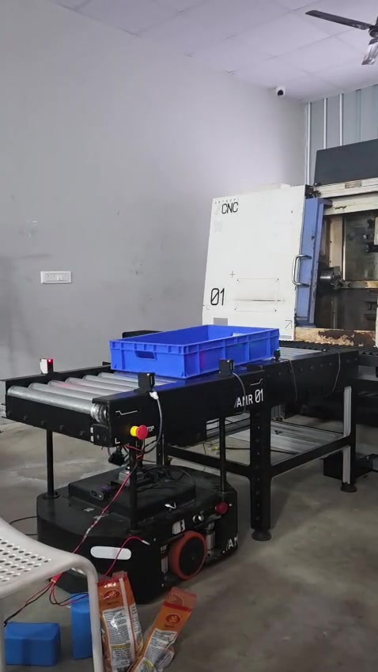
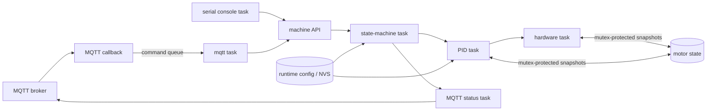

[Embedded Systems](README.md)

# Multithreaded Motion Control Firmware

Sources: [Autodoor firmware](https://github.com/anbu-05/autodoor_control_firmware) · [Conveyor firmware](https://github.com/anbu-05/conveyor_control_firmware)

I developed one ESP32-S3 motor-control firmware foundation and adapted it into
two CNC automation systems: a motorized autodoor and a tray conveyor. The shared
platform provides encoder feedback, PID control, hardware access, runtime
configuration, serial commissioning, persistent settings, and MQTT. Each
machine then supplies its own high-level state machine.

<p align="center">
  <a href="attachments/multithreaded-motion-control-firmware/conveyor-working-demo.mp4">
    
  </a>
</p>

<p align="center">
  <a href="attachments/multithreaded-motion-control-firmware/conveyor-working-demo.mp4"><strong>▶ Watch the CNC tray conveyor demonstration</strong></a>
</p>

## Firmware Architecture

The application is written in C with ESP-IDF and FreeRTOS. Because C does not
provide classes, I had to define the boundaries that classes would normally
help enforce: which module owns each operation, which state may be shared, and
which public functions other tasks are allowed to call.



All main task creation is kept in one startup file so task ownership, stack
sizes, priorities, and boot order are visible together.

| Task or module | Responsibility |
| --- | --- |
| Hardware | Reads the quadrature encoder and sensors, estimates speed, and applies motor PWM and direction. |
| PID | Runs one 10 ms controller per motor using consistent snapshots of shared state. |
| State machine | Owns complete autodoor or conveyor jobs instead of spreading transitions across other tasks. |
| MQTT | Receives queued commands, calls the same machine API as serial control, and publishes results. |
| Console | Provides strict commands for commissioning, configuration, and low-level debugging. |
| NVS/runtime config | Keeps tunable limits and learned values separate from compile-time hardware configuration. |
| Safety | Provides the stop path; further sensor-based protection is planned. |

Mutexes protect multi-field motor snapshots, while FreeRTOS queues transfer
work between contexts. MQTT callbacks only validate and enqueue messages, so a
network callback never performs a blocking machine job. A separate status task
continues publishing state while command handling is busy.

## Two Machine State Machines

The shared modules stay the same, but each machine owns different behavior.

### Autodoor

Open and close commands become PID position requests to learned endpoints. A
background homing job searches both hard stops in small position steps, detects
a sustained lack of encoder progress, records the usable range, and saves it to
NVS. Homing can be aborted asynchronously.

```text
Home open → detect stall → set zero → home closed → detect stall → save range
```

### Conveyor

The conveyor accepts receive and transmit jobs. Its two presence sensors detect
the tray at the entry and exit, but they are state-machine inputs—not motor
feedback. Motion feedback remains the encoder's responsibility.

For a receive job, the firmware waits for a tray, starts the conveyor when the
entry sensor detects it, and stops after the arrival sensor is reached. For a
transmit job, it verifies that a tray exists, moves it out, and finishes when
both sensors are clear. Phase and overall timeouts turn missing or stuck trays
into explicit job failures.

## MQTT Control

MQTT connects each controller to the CNC automation backend. Every command
contains a command ID, is acknowledged as received, and later gets a success or
failure result. Separate status messages report the current machine state and
tray presence.

The MQTT layer does not access motor pins. It translates remote commands into
the same public state-machine functions used by the serial console. This keeps
networking, machine behavior, PID control, and hardware access independently
testable.

## Current Status

Both variants run on their target hardware and demonstrate how the same
procedural, multithreaded firmware can be retargeted from a position-controlled
door to a sensor-driven conveyor. The main unfinished area is the safety layer;
motor-current sensing and broader fault handling are planned next.
