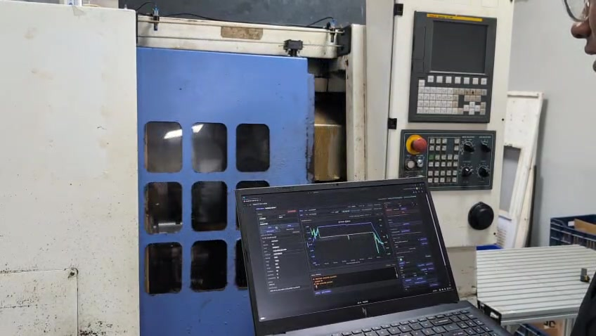

[Embedded Systems](README.md)

# Servo PID Controller and Tuner

Sources: [Autodoor firmware](https://github.com/anbu-05/autodoor_control_firmware) · [Conveyor firmware](https://github.com/anbu-05/conveyor_control_firmware)

I built a reusable PID motor controller and browser-based tuning interface for
ESP32-S3 servo systems. I used the same foundation in two CNC automation
projects: a motorized door and a tray conveyor.

PID tuning normally requires many repeated changes and tests. The browser tuner
made that process interactive: I could change gains, command a target, and see
the motor response immediately instead of repeatedly typing serial commands.

<p align="center">
  <a href="attachments/servo-pid-controller-and-tuner/autodoor-working-demo.mp4">
    
  </a>
</p>

<p align="center">
  <a href="attachments/servo-pid-controller-and-tuner/autodoor-working-demo.mp4"><strong>▶ Watch the autodoor PID tuning and homing demonstration</strong></a>
</p>

## Controller

The controller can switch between position and speed modes. Both modes use the
same 10 ms control loop; only the error source changes:

```text
Position error = target position - encoder position
Speed error    = target speed - measured speed
PID output     = Kp(error) + Ki(integral) + Kd(derivative)
```

The signed PID output is converted directly into motor direction and PWM. The
implementation also includes:

- Quadrature-encoder position and speed feedback.
- Runtime switching between position and speed control.
- Configurable position tolerance and maximum PWM.
- Integral clamping to reduce windup.
- Position and speed target bounds.
- PID-state reset when the mode, gains, or control ownership changes.
- An immediate stop path that disables PID control and cuts PWM.

The confirmed autodoor gains are stored as integer milli-units for the serial
interface and converted to floating point for the control calculation:

| Gain | Firmware value | Controller value |
| --- | ---: | ---: |
| Kp | 500 | 0.5 |
| Ki | 5000 | 5.0 |
| Kd | 150 | 0.15 |

## Browser Tuner

The tuner uses FastAPI and PySerial to connect a browser to the ESP32-S3. One
serial connection carries commands and console responses, while a second UART
streams timestamped position, speed, and PWM telemetry through WebSockets.
Chart.js plots the position and speed response live.

My tuning workflow was:

1. Select position or speed mode.
2. Set Kp, Ki, Kd, output limits, and target bounds.
3. Command a position or speed target.
4. Inspect overshoot and settling on the live graph.
5. Adjust the values and repeat.

The interface also exposes raw motor controls, open/close and homing actions,
sensor state, runtime configuration, NVS snapshots, and a serial terminal. This
kept commissioning and debugging in one place while still using the firmware's
strict serial commands.

## Autodoor Homing

The autodoor does not depend on presence sensors for motion. Its homing routine
moves toward each mechanical endpoint in steps of roughly 250 encoder counts.
If the encoder stops making enough progress for the configured timeout, the
firmware treats that sustained stall as the endpoint. It zeroes the open side,
learns the closed position, updates the allowed range, and saves the result.

The deliberate stepped search explains the jerky motion in the demonstration;
it is homing behavior rather than unstable PID control.

## Next Steps

The graph showed that the tuned controller reached its target with minimal
overshoot. My next goal is to identify a motor-and-mechanism model from the
telemetry, then investigate root-locus-based gain selection as an automatic
tuning method.

Target limits and an emergency stop are implemented, but the complete safety
layer is still in progress. I plan to add motor-current sensing so overloads and
stalls can be detected independently of encoder movement.
